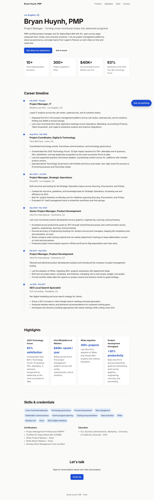

# Personal website

A one-page site (career timeline, highlights, skills, contact) plus a chat assistant
that answers visitors' questions about you.

## Editing your content
Everything lives in **profile.json**. The page and the chatbot both read it, so update it once.
- Anything in `[square brackets]` is a placeholder. The chatbot treats those as unknown and won't make up an answer.
- `chatbot_notes` holds extra facts only the chatbot uses (work style, what roles you're open to, topics to avoid).

## Headshot and job photos
Go to **/admin.html** on your site and sign in with your admin password. There you can upload your headshot
(shown next to your name, in the contact section and in the chat window; your initials show until you add one)
and upload photos under any job.
You can add a caption, edit it later, or delete a photo. Big phone photos are resized automatically.
Photos are stored in Vercel Blob, not in this folder.

You can also hard-code a photo in profile.json under a job's `photos` list:
`{ "src": "images/jobs/launch.jpg", "caption": "Launch day" }`

## Files
- `index.html`, `styles.css`, `app.js`: the page (renders from profile.json)
- `admin.html`, `admin.js`: password-protected photo manager
- `api/photos.js`: photo upload, caption and delete API (Vercel Blob)
- `api/chat.js`: serverless function that calls the Claude API (model `claude-opus-5-5`, override with `CLAUDE_MODEL`)
- `dev-server.mjs`: local preview

## Run locally
    npm install
    ANTHROPIC_API_KEY=sk-ant-... npm run dev   # http://localhost:3000

## Deploy (Vercel, free Hobby plan)
1. Push this folder to a GitHub repo.
2. Import the repo at vercel.com/new (no build settings needed).
3. In Project Settings > Environment Variables add `ANTHROPIC_API_KEY` and `ADMIN_PASSWORD` (a long password only you know).
4. In the Storage tab, create a Blob store and connect it to the project (this adds `BLOB_READ_WRITE_TOKEN`). Redeploy.
5. Optionally attach your own domain.

Chat cost: each question is one Claude API call billed to your Anthropic account. Set a monthly
spend limit in the Anthropic Console to cap it.
